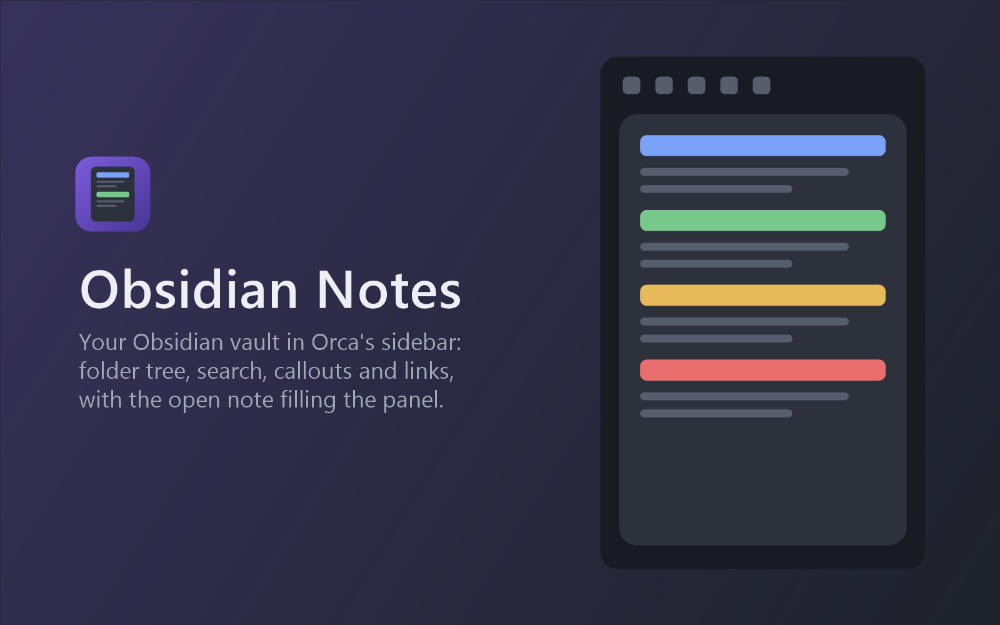

<div align="center">

#  Obsidian Notes for Orca

**Your Obsidian vault in Orca's sidebar, with the open note filling the whole panel**

[](https://github.com/stablyai/orca)
[](#-how-it-works)
[](https://obsidian.md/)



</div>

---

## ✨ What this is

An Orca plugin that reads the notes of an Obsidian vault in the sidebar, without leaving Orca.

| | Feature | What it does |
|---|---|---|
| 📖 | **Full-panel reading** | The open note fills the panel; the tree and the search are a segment away, with back and forward like a browser |
| 🧾 | **Orca's Markdown** | Nested lists, links, tables and code |
| 🪨 | **Speaks Obsidian** | Shows the properties, draws callouts and tasks, hides `%% comments %%`, and turns `[[links]]` to notes and files into buttons that open them, where they are in the text |
| 🖼️ | **Images and READMEs** | Images show in the note, and a README keeps its centered blocks, its sizes and its badges |
| 🧩 | **Mermaid flowcharts** | Drawn in the note, in Orca's light or dark colors |
| 📎 | **Files** | A linked or attached file (`[[hours.json]]`, `attachments`) opens in its app; never one that could run code |
| 🔗 | **Backlinks** | Under each note, the notes linking to it; a link to a note that does not exist shows, but cannot be pressed |
| 🎨 | **Sections that stand apart** | Each `##` gets a color no other section of the note has, which its subheadings carry too |
| 🗂️ | **Several vaults** | Added with the folder picker or by pasting the path, and switched from the panel's head |
| 🔄 | **Up to date** | When a note changes on disk, the tree and the open note follow |
| 🔎 | **Search** | By name and by content as you type, grouped by folder, or by `#tag` from the vault's tags |
| ↗️ | **Open in Obsidian** | Opens the note in the app, even when the added folder is a subfolder of the vault |
| 🌍 | **In Orca's language** | English or Spanish |

---

## 🧭 How it works

- **Two parts.** The panel runs inside Orca, with no access to the disk; the worker runs in
  Node and is the only part that reads the vaults. They talk through a contract in
  `src/protocol.ts`.
- **No build step.** Orca loads the `.ts` and `.tsx` files as they are; `node_modules` only
  brings the development types.
- **Read-only.** It never writes to a vault. It keeps the list of vaults and, in the plugin's
  `cache/` folder, a copy of the images it shows and the pictures it draws (up to 200 MB).
- **Only the added vaults.** The worker refuses any path that leaves one, symbolic links
  included. It makes no network calls: nothing leaves the machine.

---

## 🚀 Getting started

```bash
orca plugin install moilolon/orca-obsidian-notes
```

Orca shows the access the plugin asks for and the command to approve it. Then open the
**Obsidian** panel in the right sidebar and pick the vault's folder in its settings. To work on
the plugin, install it from a clone with `orca plugin install .` (with `node_modules` left
out), and again after each change: Orca installs a copy of the folder.

---

<div align="center">
<sub><a href="https://moilolon.com">moilolon.com</a> · <a href="https://github.com/moilolon">@moilolon</a></sub>
</div>
